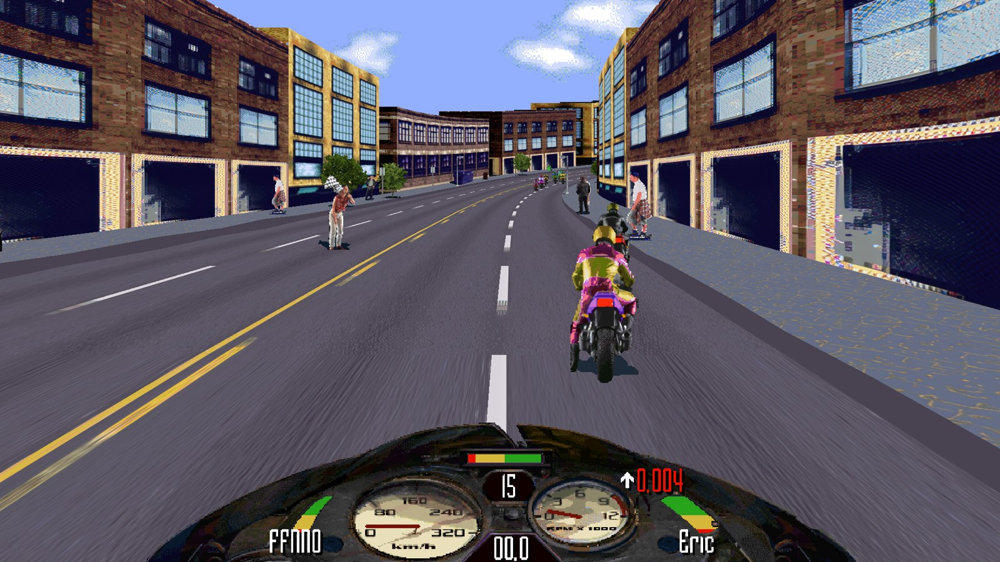
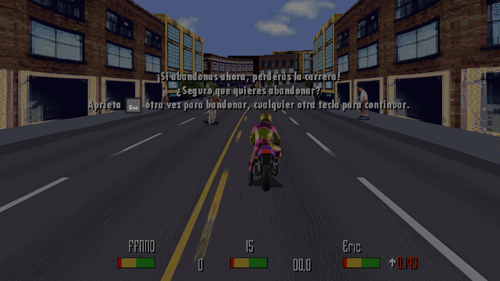

<h1 align="center">Road Rash 95 FFNNO Patch</h1>

<p align="center">
  <a href="https://github.com/FFNNO/RoadRashFFNNOPatch/releases/latest"></a>
  <a href="https://github.com/FFNNO/RoadRashFFNNOPatch/actions/workflows/release.yml"></a>
</p>

<p align="center">
  <a href="https://x.com/PagaTeamDev"></a>
  <a href="https://cafecito.app/pagateam"></a>
</p>

**Players:** download `RoadRashFFNNOPatch-Setup-<version>.exe` from the [latest release](https://github.com/FFNNO/RoadRashFFNNOPatch/releases/latest). Every release is built by GitHub Actions from the tagged commit and lists the SHA-256 of the setup.

A proxy `ddraw.dll` for **Road Rash 95** (Steam 30th Anniversary Edition, app 2448570) that replaces the game's 640x480 software renderer with Direct3D 11:

- the 3D world is drawn on the GPU at 1440x1080 (4:3) at a locked 60 fps;
- optional widescreen race view: the world fills a 16:9 (or wider) window with a wider field of view, while the HUD stays a centred 4:3 layer;
- far view: the road is drawn 72 segments ahead instead of the engine's 48, and the farthest segments fade into the sky instead of popping in;
- thin far rows of road are kept, so far fewer rows of ground go missing at 1080p;
- sub-pixel sprite corners and trilinear mipmaps, so buildings no longer jump pixel by pixel;
- HUD key icons (for example the ESC icon in the pause prompt) are drawn with the GPU world;
- a high-resolution texture pack (4x upscaled with AI) that replaces game textures by ID;
- one-click saving and loading to a fixed file, with an on-screen "Partida guardada" / "Partida cargada" message.

Widescreen and far view can be switched from the game's own graphics menu (see [In-game options](#in-game-options)).

Nothing in the game's data files is modified. Deleting the DLL restores the original game. The story of how it was built is in [docs/PROCESS.md](docs/PROCESS.md).

**No game files are included.** You need your own copy of Road Rash 95 on Steam. Game executables, decompilation, texture dumps and texture packs are kept out of this repository on purpose.

## Screenshots



*La Ciudad at 1920x1080: widescreen on, GPU world, texture pack.*



*The pause prompt with its ESC key icon, drawn with the GPU world.*

## Install with the wizard

1. Get `RoadRashFFNNOPatch-Setup-<version>.exe` from the [releases](https://github.com/FFNNO/RoadRashFFNNOPatch/releases), or build it yourself: install [Inno Setup 6](https://jrsoftware.org/isinfo.php) and the build tools from section 1, then run `cmd //c "installer\\build.bat"`. It builds `ddraw.dll` and writes the setup to `installer/Output/`. If ISCC is not found, set the `ISCC` variable to the full path of `ISCC.exe`.
2. Close the game and run the setup. It finds the game folder from the registry or your Steam libraries, and it only continues when `RoadRash95.exe` is in the chosen folder. If it cannot write there, run it as administrator.
3. Choose the options. `ddraw.dll` and `rr95gpu.ini` are always installed.

| Option | Default | What it does |
|---|---|---|
| GPU world | on | `[World] GpuWorld=1`: the 3D world at 1440x1080 on the GPU (Scroll Lock toggles it in race) |
| Fixed save file | on | `[Save] Enabled=1`: saving writes `Partida 1.RRS` in the game folder without a dialog (section 4). Back up your existing `.RRS` saves first. |
| HD texture pack | off | Copies every `<w>x<h>_<crc32>.png` from a folder you choose to `texture-pack\` and sets `[TexturePack] Enabled=1`, `MaxMiB=1536` |
| Texture dump | off | `[TexturePack] Dump=1`: saves each new texture to `texture-dump\` to grow a pack (section 5) |

**The texture pack is not included in the setup.** It is derived from the game's art, so you build it yourself (section 5) or point the setup at a pack you already have.

Existing `ddraw.dll`, `rr95gpu.ini` and `texture-pack\` are kept as `*.pre-ffnno` backups. **Uninstall** from Apps & features (Settings > Apps): it removes `ddraw.dll`, `rr95gpu.ini`, `rr95gpu.log` and the `texture-pack\` it created, and restores the backups. Your saves (`*.RRS`), `texture-dump\` and all game files are never touched.

Some antivirus tools may flag the proxy `ddraw.dll`, because it patches the game's code in memory. It does not modify any game file.

Silent install, for example: `RoadRashFFNNOPatch-Setup-0.1.2.exe /VERYSILENT /CURRENTUSER /DIR="<game folder>" /TASKS="gpuworld,save,texturepack" /PACKDIR="<pack folder>"`. To test the installer without touching your game, run `python -I installer/tests/test_installer.py`. It installs into temporary fake game folders and uninstalls again.

## 1. Requirements

| Tool | Version used | Needed for |
|---|---|---|
| Windows 10/11 x64 | Windows 11 | everything |
| Road Rash 95 (Steam) | 30th Anniversary Edition | everything |
| Visual Studio Community with "Desktop development with C++" (MSVC x86, Windows SDK, CMake) | VS 18 (2026), MSVC 14.51, SDK 10.0.26100 | building `ddraw.dll` |
| Python 3 with Pillow and numpy | Python 3.14, Pillow 12.2, numpy 2.3 | texture tools, tests |
| A GPU with Direct3D 11 | RTX 3070, 8 GB | running; the full pack needs about 1 GB of VRAM |
| Real-ESRGAN ncnn-vulkan + 4x_Remacri model | v0.2.5.0 | only to (re)build the texture pack |
| Ghidra | 12.1.4 | only for reverse engineering |
| Inno Setup | 6.7.4 | only to build the installer |

```bash
python -m pip install pillow numpy
```

## 2. Build

From the repository root (Git Bash or cmd):

```bash
cmd //c "renderer\\build.bat"
```

`renderer/build.bat` expects Visual Studio at `C:\Program Files\Microsoft Visual Studio\18\Community`. Edit the `VCVARS` and `CMAKE` paths at the top of the file if yours is elsewhere.

Output in `renderer/build/Release/`:
- `ddraw.dll`: the patch (32-bit);
- `hook_test.exe`, `forward_test.exe`: tests.

### Tests

```bash
renderer/build/Release/hook_test.exe       # unit tests, must end with "OK (0 failure(s))"
renderer/build/Release/forward_test.exe    # DirectDraw forwarding
python renderer/tools/check_hook_sites.py  # needs original/ and patched/ exes, see section 7
python -I tools/upscale.py --self-test     # texture upscaler
```

## 3. Install manually

The alternative to the wizard. Game folder (default): `C:\Program Files (x86)\Steam\steamapps\common\RoadRash`

1. Close the game.
2. Copy `renderer/build/Release/ddraw.dll` next to `RoadRash95.exe`.
3. Copy `renderer/rr95gpu.ini` next to it and set the recommended values below.
4. Copy a texture pack folder as `texture-pack/` next to it (optional, see section 5).
5. Start the game from Steam. `rr95gpu.log` in the game folder shows what loaded, for example `TexturePack: preload done, 1573 loaded in 12828 ms (0 rejected, 0 failed)` and `FPS: 60.0`.

The DLL checks the exe's SHA-256 and the exact bytes at every hook site. On an unknown exe build it logs the mismatch and stays out of the way.

### Recommended `rr95gpu.ini`

Start from `renderer/rr95gpu.ini` (every key is documented there) and change:

```ini
[World]
GpuWorld=1          ; GPU world at 1440x1080 (Scroll Lock toggles it in race)
; Defaults you can keep (GpuWorld=1 only):
; DrawSegments=72        ; road segments drawn ahead (48 = the engine's own distance, 72 = most)
; DistanceFade=1         ; the farthest segments fade into the sky instead of popping in
; DistanceFadeStart=0.8  ; fade starts at this fraction of the farthest depth (0.8 = last fifth)
; KeepThinQuads=1        ; draw far one-scanline rows (fixes missing rows of ground and finish line)
; Widescreen=off         ; off, auto (window aspect) or an even width 320..640 (426 = 16:9)

[TexturePack]
MaxMiB=1536         ; the full Remacri pack needs about 1025 MiB of VRAM
Dump=0              ; 1 = save every new texture the game draws to texture-dump/ (to grow the pack)
```

`[World]` keys added since v0.1.0 (all need `GpuWorld=1`; every key is documented in `renderer/rr95gpu.ini`):

| Key | Default | What it does |
|---|---|---|
| `DrawSegments` | `72` | Road segments drawn ahead. `48` leaves the engine unchanged; `49..72` patch it at race start. 72 is the maximum, because the game streams only 80 segments ahead. Roadside objects and traffic still appear at the original distance. |
| `DistanceFade` | `1` | `1` = the farthest segments fade into the sky; `0` = drawn as before. |
| `DistanceFadeStart` | `0.8` | Where the fade starts, as a fraction of the farthest segment's depth (0 to just below 1). |
| `KeepThinQuads` | `1` | `1` = keep far textured rows that fall on one scanline at 640x480 but still have height at 1080p; `0` = cull them like the software renderer. Needs `SubPixel=1`. |
| `Widescreen` | `off` | `off` = 4:3; `auto` = width from the window aspect (1920x1080 gives 426); `<n>` = fixed even width 320..640. Needs the game's high-resolution mode. |

### In-game options

With `GpuWorld=1` the game's "Opciones Gráficas y de Sonido" (graphics and sound options) menu has 9 items with wider buttons, including two On/Off items labelled in the game's language:

| Item (English / Spanish) | Registry value | On | Off |
|---|---|---|---|
| "Widescreen" / "Pantalla panorámica" | `Widescreen` | `auto` widescreen | 4:3 |
| "Far view" / "Vista lejana" | `FarView` | `DrawSegments=72` with `DistanceFade=1` | the engine's 48 segments without the fade |

Both values live under `HKCU\SOFTWARE\Electronic Arts\RoadRash 95`. Once a value exists it overrides the matching ini keys; delete it to go back to the ini. Changes apply at the next race start. `KeepThinQuads` is ini-only.

### Uninstall

Delete `ddraw.dll`, `rr95gpu.ini`, `rr95gpu.log` and `texture-pack/` from the game folder.

## 4. Saving

With `[Save] Enabled=1` (default), "Salvar Juego", "Salvar Juego Como..." and the save before quitting write `[Save] File` (default `Partida 1.RRS` in the game folder) without a file dialog. "Cargar Juego" loads that file without a dialog when it exists. Back up your `.RRS` file before the first use.

## 5. Texture pack

The pack is a folder of PNGs named by texture ID, `<w>x<h>_<crc32>.png`. Each replacement must be exactly 1x, 2x, 4x or 8x the original size; any other size is rejected with a log line. The pack is not in this repository.

### Moving an existing pack to another PC
Copy these folders from the old PC (they are git-ignored):
- `<game folder>\texture-pack\`: the pack in use (1573 Remacri textures, about 300 MB);
- `<game folder>\texture-dump\`: the original textures with `manifest.json`, needed to upscale again;
- `out\tools\realesrgan\`: the upscaler with its models, including `models\remacri-4x.param/.bin`.

### Building a pack from scratch
1. **Collect textures.** Set `[TexturePack] Dump=1`, play every track (or let the demo mode run), and the DLL writes each new texture to `<game folder>\texture-dump\` with `manifest.json`. They are converted with the game's base palette `DATA\PALETTE.RAW`.
2. **Get the upscaler.** Download `realesrgan-ncnn-vulkan-20220424-windows.zip` (v0.2.5.0) from the [Real-ESRGAN releases](https://github.com/xinntao/Real-ESRGAN/releases) into its own folder, for example `out\tools\realesrgan\`. For the current look, add the **4x_Remacri** ESRGAN model (listed on [OpenModelDB](https://openmodeldb.info/)) converted to ncnn as `models\remacri-4x.param` and `models\remacri-4x.bin`; the bundled `realesrgan-x4plus` also works but looks smoother.
3. **Copy the dump into the repo** (the tool reads it from there):
   ```bash
   mkdir -p out/b6-runtime/texture-dump
   cp "/c/Program Files (x86)/Steam/steamapps/common/RoadRash/texture-dump/"* out/b6-runtime/texture-dump/
   ```
4. **Upscale:**
   ```bash
   EXE="$PWD/out/tools/realesrgan/realesrgan-ncnn-vulkan.exe"
   python -I tools/upscale.py --dump out/b6-runtime/texture-dump --out out/b6-runtime/texture-pack-4x-remacri \
     --scale 4 --edge-band 1 --external-batch 100 \
     --external "\"$EXE\" -i {in} -o {out} -n remacri-4x -s 4 -f png"
   ```
   Existing outputs are skipped (use `--force` to redo them), so after more play only new textures are processed. 1573 textures take about 25 minutes on an RTX 3070. Use `--edge-band 6` with `realesrgan-x4plus`.
5. **Install:** close the game and copy `out/b6-runtime/texture-pack-4x-remacri/` to `<game folder>\texture-pack\`. Raise `MaxMiB` if the log says it was reached.

What `upscale.py` does for colour-keyed sprites: it bleeds colours into transparent texels, upscales the silhouette with the same model so alpha follows the new edge, recolours a thin outer band from the sprite's interior to remove photo halo pixels, and batches images **by size** (realesrgan-ncnn-vulkan v0.2.5 returns striped garbage when one call mixes many sizes).

## 6. Optional exe byte patch

`scripts/patch.py` applies small byte patches to the exe (stop snapping sprites to even pixels in HiRes mode). It checks the original bytes first, keeps a backup and is reversible. The DLL works with or without it.

```bash
py -I scripts/patch.py build     # writes patched/RoadRash95.exe from original/RoadRash95.exe
py -I scripts/patch.py install   # backs up the Steam exe to RoadRash95.exe.orig and installs the patched one
py -I scripts/patch.py restore   # puts RoadRash95.exe.orig back
```

Copy the Steam `RoadRash95.exe` to `original/RoadRash95.exe` first (git-ignored).

## 7. Reverse engineering setup (optional)

- `original/RoadRash95.exe`: copy of the Steam exe (SHA-256 `9e40e25737149ab095061b7154797a35495faea97644fafc5a1e616f1400c968`); `patched/RoadRash95.exe` from `scripts/patch.py build`.
- `scripts/analyze.bat` runs Ghidra headless and writes the decompilation to `out/` (`out/decomp.c`, `out/imports.tsv`). Set `GHIDRA_DIR` to your Ghidra install first.
- `tools/famrsc.py`, `tools/texdump.py`: decode the game's FAM/RSC archives and dump their textures.
- Engine facts (function addresses, data layout) are in `odd/tasks/rr95-gpu-renderer.md`.

## 8. Repository layout

| Path | Contents |
|---|---|
| `renderer/` | the proxy DLL (C++17, CMake): `src/` sources, `tests/` unit tests, `tools/` frame and hook-site checkers, `rr95gpu.ini` sample config |
| `tools/` | Python tools: `upscale.py` (texture pack), `texdump.py`, `famrsc.py`, `extract_funcs.py` |
| `scripts/` | exe byte patcher, Ghidra export script and runner, RSC probe |
| `docs/PROCESS.md` | how the project was built |
| `odd/tasks/` | feature documents with tasks, evidence and progress |

Git-ignored local folders: `original/`, `patched/`, `ghidra/`, `ghidra-home/`, `out/`, `dumps/`, `texture-pack/`, `build/`.

## 9. Troubleshooting

- **No change in game:** check `rr95gpu.log`. A line about an unknown exe build means the Steam exe changed; the hook bytes must be updated.
- **Pixelated vehicles on a track:** that track's textures are not in the pack yet. Set `Dump=1`, play it, and upscale the new textures (section 5).
- **`MaxMiB ... reached` in the log:** raise `[TexturePack] MaxMiB` (up to 2048).
- **The game hangs when the window is closed mid-race:** this is the original game's behaviour too; quit from the menu.
- **Diagnostic log lines:** with `GpuWorld=1`, `rr95gpu.log` writes `ThinQuads:` (why thin far rows were kept or culled) and `RoadSlices:` (road slices dropped by the engine's horizon rule) every 5 seconds during a race, and `Draw distance: <n> segments for this race` at race start.

## Known issues

- **Missing roadside ground textures on some PCs.** Some players report roadside ground without textures. It has not been reproduced yet and is under investigation. To help, open an issue with:
  - `rr95gpu.log` from the game folder, after a race where it happened;
  - your GPU model and driver version;
  - whether it also happens in software mode: press Scroll Lock in race to switch between the GPU world and the original renderer and compare.
- **Rare gap in the far ground.** Thin far rows whose 16.16 corners have zero height are still culled, so a gap can very rarely show for a moment.
